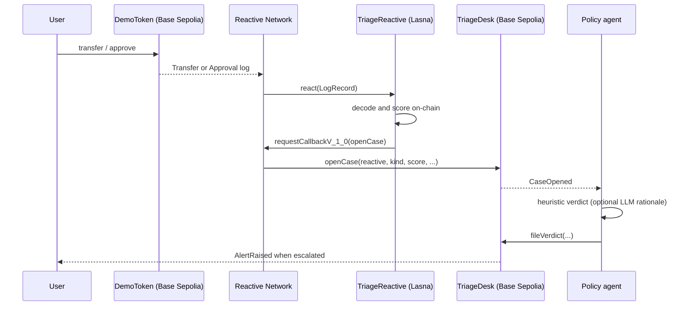

# Triage

**Leave a clerk watching your approvals.**

Triage is an entry for the [Reactive Omni Buildathon](https://dorahacks.io/hackathon/reactive-omni-buildathon). A Lasna reactive contract watches Transfer and Approval logs on Base Sepolia, scores them on-chain, and opens a case on a destination desk through an authenticated Reactive callback. A policy agent that ships in this repository — part of the running system, not just a tool used to write the code — files a verdict. Unlimited approvals are escalated as on-chain alerts.

Primary track: **Reactive Meets AI**. The same loop is also a usable personal automation in the spirit of *Set It and Forget It*.

> Testnet only. This repository is configured for Base Sepolia (chain 84532) and Reactive Lasna (chain 5318007). Do not deploy to mainnet or use a wallet that holds real funds.

## Why this exists

Unlimited ERC-20 approvals are still how everyday wallets get drained. The usual advice is “check the explorer yourself.” Triage is the clerk you leave running instead: every relevant log becomes a case, every case gets a score, and the risky ones raise an on-chain alert you can actually subscribe to.

It is deliberately not another “freeze the vault when a transfer is large” demo. The reactive contract does the scoring. The destination contract keeps a case file. The agent decides whether to record, watch, or escalate.

## How it works



1. **Origin.** `DemoToken` on Base Sepolia emits standard `Transfer` and `Approval` logs. Any ERC-20 with those topics can be watched; the demo token is included so the loop is self-contained.
2. **Reactive.** `TriageReactive` on Lasna subscribes to that token (specific chain, contract, and topic0). `react()` authenticates the system contract, ignores mismatches without reverting, scores the event, and requests a V1 callback.
3. **Destination.** `TriageDesk` on Base Sepolia accepts `openCase` only from the official Base Sepolia callback proxy, and only when the injected sender is the reactive contract. The first argument of the payload is the `address(0)` placeholder required by Reactive Omni.
4. **Policy.** `services/policy` classifies the open case and files a verdict. The default heuristic needs no API key. If `OPENAI_API_KEY` is set, the agent may rewrite the rationale; it cannot change the action.

## Repository layout

```
src/                  DemoToken, TriageScore, TriageReactive, TriageDesk
test/                 Foundry tests with a mocked system contract at 0x8888…8888
services/policy/      In-loop policy agent and its unit tests
scripts/              Testnet deploy, lREACT faucet helper, demo events
demo/                 Walkthrough, case fixtures, storyboard frames, silent video
deployments/          Filled in after a successful testnet deploy
lib/reactive-lib-omni Official Reactive Omni library, vendored at v0.1.0
```

## Quick start

Foundry (`forge` / `cast`) and Python 3.10+ are required.

```bash
export PATH="$PATH:$HOME/.foundry/bin"
forge test
python3 -m unittest discover -s services/policy/tests
python3 -m services.policy.agent --dry-run --cases demo/cases.json
```

Expected result: 20 Solidity tests and 7 policy tests pass, and the agent prints four verdicts (mint = record, routine transfer = record, large transfer = watch, unlimited approval = escalate).

## Testnet deploy (free faucets only)

The scripts refuse any chain id other than `84532` and `5318007`.

1. Copy `.env.example` to `.env` and put a **fresh throwaway testnet key** in `PRIVATE_KEY`. `cast wallet new` will generate one. Never use a mainnet key or a wallet that holds real funds.
2. Fund that address with Base Sepolia ETH from a free faucet. If the faucet asks for a captcha or a login, complete it yourself; do not wire a paid service or an existing funded wallet into this project.
3. Swap a little of that ETH for Lasna lREACT:

   ```bash
   ./scripts/request-lreact.sh
   ```

   This calls the official faucet at `0x2afaFD298b23b62760711756088F75B7409f5967` (`request(address)`), which pays 100 lREACT per 1 ETH sent, max 5 ETH per request.
4. Deploy:

   ```bash
   ./scripts/deploy-testnet.sh
   ```

   Addresses and deploy hashes are written to `deployments/testnet.json`.
5. Emit the demo events, wait for the Lasna `react` transaction and the Base Sepolia callback, then file verdicts:

   ```bash
   ./scripts/emit-demo-events.sh
   python3 -m services.policy.agent --cases demo/cases.json --dry-run
   # After cases exist on-chain, file them (case ids must match the desk):
   python3 -m services.policy.agent --cases path/to/opened.json \
     --rpc-url "$BASE_SEPOLIA_RPC" --desk "$DESK" --private-key "$PRIVATE_KEY"
   ```

6. Record the full loop for the hackathon submission: origin event hash, Lasna `react` hash, destination callback hash. Put them in `deployments/loop.json`.

## Scoring

The reactive contract scores events before it requests a callback, so the desk already has a useful severity:

| Event | Score | Default agent action |
| --- | --- | --- |
| Dust transfer (≤ 0.001 tokens) | 10 | record |
| Mint (`from == 0`) | 20 | record |
| Burn (`to == 0`) | 30 | record |
| Routine transfer | 35 | record |
| Routine approval | 45 | record |
| Large approval (≥ 10,000 tokens) | 70 | watch |
| Large transfer (≥ 1,000 tokens) | 75 | watch |
| Unlimited approval (≥ `type(uint128).max`) | 90 | **escalate** (emits `AlertRaised`) |

Thresholds are constructor arguments on `TriageReactive`.

## Networks and official addresses

| Role | Network | Chain ID | Address / RPC |
| --- | --- | --- | --- |
| Origin + destination | Base Sepolia | 84532 | RPC `https://sepolia.base.org`, explorer [sepolia.basescan.org](https://sepolia.basescan.org) |
| Callback proxy | Base Sepolia | 84532 | `0x476F44b11F5C942c58f4c8E3d0300E5710743585` |
| Reactive contract | Lasna | 5318007 | RPC `https://lasna-rpc.rnk.dev/`, explorer [lasna.reactscan.net](https://lasna.reactscan.net) |
| System contract | Lasna | 5318007 | `0x8888888888888888888888888888888888888888` |

Mainnet Reactive (chain 1597) is out of scope and is not referenced by the deploy scripts.

## Judging notes

- **Execution.** Foundry tests drive a complete origin log → `react()` → callback-proxy delivery → `openCase` → `fileVerdict` loop, including the first-word sender injection the Omni callback proxy performs. After faucet funding, the same loop is meant to be shown with live Lasna and Base Sepolia transaction hashes.
- **Integration.** The reactive contract is not a thin relay. It decodes the log, scores it, emits `CaseRequested`, and only then requests the callback. Mismatched chain, token, or topic are ignored without reverting, which matters because a revert on Lasna is still billed in full.
- **Usefulness.** This is a personal clerk for approvals and transfers that you can leave running. The escalated `AlertRaised` event is something a wallet, a bot, or a Safe owner can actually watch.
- **Craft.** The Omni library is vendored at `v0.1.0`, tests sit next to the contracts, the policy agent is covered separately, and this README is enough to rebuild and demo the loop.

## Demo assets

- `demo/cases.json` — the four canonical cases used by the agent walkthrough
- `demo/walkthrough.md` — narration beats for a sub-3-minute video
- `demo/frames/01-title.png` … `08-tests.png` — storyboard
- `demo/triage-walkthrough.mp4` — silent stitch of those frames
- `demo/index.html` — a one-page visual of the loop you can open locally

## CI

A GitHub Actions workflow lives in the local working tree at `.github/workflows/ci.yml` and runs `forge test` plus the policy unit tests. The copy pushed to GitHub omits that file because the `gh` token used for this repository lacks the `workflow` scope. After granting that scope, add and push the file.

## License

MIT for the Triage source in this repository. `lib/reactive-lib-omni` is vendored from [Reactive-Network/reactive-lib-omni](https://github.com/Reactive-Network/reactive-lib-omni) `v0.1.0` and keeps its original SPDX identifiers. `lib/forge-std` is the Foundry standard library (`v1.11.0`).
